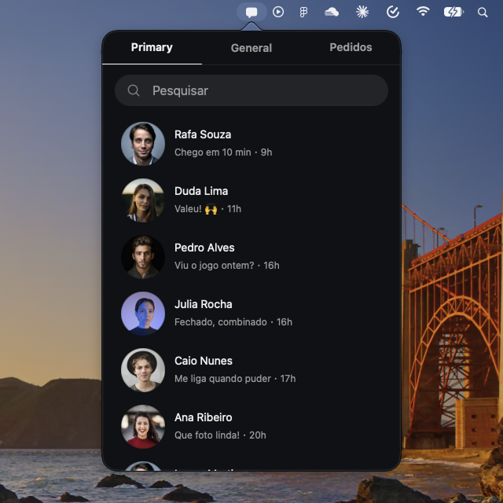
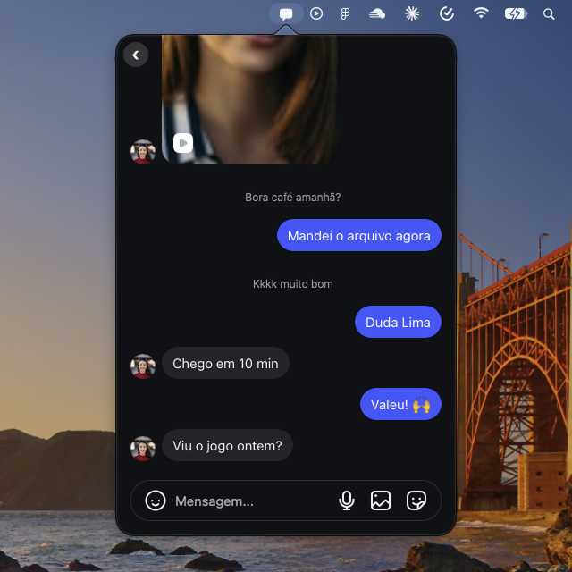
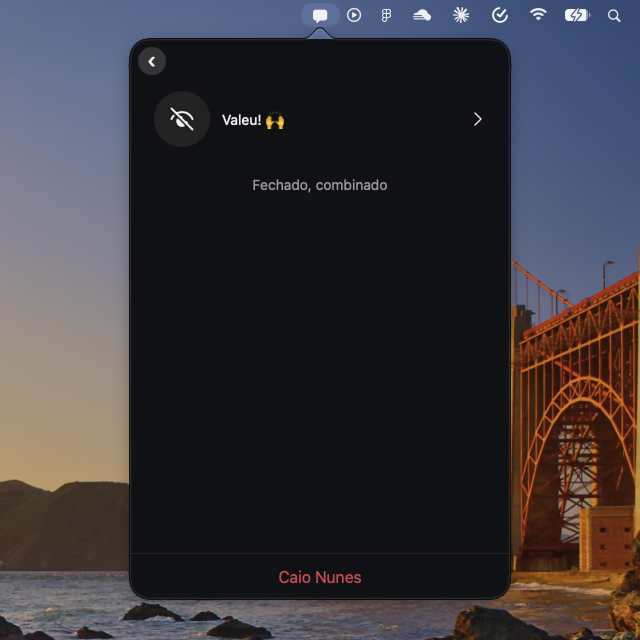

<div align="center">


# DMBar

**Suas DMs do Instagram na barra de menu do macOS.**


[Recursos](#recursos) • [Instalação](#instalação) • [Uso](#uso) • [Como funciona](#como-funciona) • [Limitações](#limitações)

<a href="README.md">English</a> • Português

</div>

DMBar é um app nativo de barra de menu que mostra só as mensagens diretas do Instagram. Você lê e responde sem abrir o navegador e sem ver feed, stories ou reels.

O app carrega a versão web oficial do Instagram num `WKWebView`. Ele não usa API privada do Instagram nem automatiza requisições.

<p align="center">
  
  
  
</p>

> [!NOTE]
> DMBar é um projeto independente. Ele não tem relação com o Instagram nem com a Meta.

## Recursos

- **Só DMs:** lista de conversas e chat em um popover de 380x560, sem barra de navegação, feed ou Notas.
- **Login persistente:** entre uma vez com usuário e senha ou com Facebook. O 2FA funciona dentro do app.
- **Badge de não lidas:** o número de conversas não lidas aparece ao lado do ícone na barra de menu.
- **Notificações nativas:** um aviso aparece quando chega mensagem com o popover fechado. Clicar no aviso abre o popover.
- **Atalho global:** <kbd>⌥</kbd> <kbd>D</kbd> abre e fecha o DMBar de qualquer app.
- **Abrir ao iniciar o Mac:** opção no menu do ícone.
- **Sem ícone no Dock:** o app vive só na barra de menu.

## Instalação

### Baixar a versão pronta

1. Baixe o `DMBar.zip` da [última release](https://github.com/CarlosAllberto/dmbar/releases/latest).
2. Descompacte e mova o `DMBar.app` para `/Applications`.
3. Abra o app.

> [!NOTE]
> O app ainda não é notarizado pela Apple, então o macOS pede uma confirmação na primeira abertura. Para liberar, vá em **Ajustes do Sistema > Privacidade e Segurança** e clique em **Abrir Mesmo Assim**.

As releases são compiladas pelo GitHub Actions a cada tag `v*`, a partir deste repositório.

### Compilar a partir do código

Requisitos:

- macOS 13 ou superior
- Xcode 15 ou superior
- [XcodeGen](https://github.com/yonaskolb/XcodeGen)

```bash
brew install xcodegen
```

O projeto Xcode é gerado a partir do [`project.yml`](project.yml) e não fica no repositório.

```bash
git clone https://github.com/CarlosAllberto/dmbar.git
cd dmbar
xcodegen generate
xcodebuild -project DMBar.xcodeproj -scheme DMBar -configuration Release -derivedDataPath build build
```

O app fica em `build/Build/Products/Release/DMBar.app`. Copie para `/Applications` e abra.

> [!TIP]
> Para desenvolver, abra `DMBar.xcodeproj` no Xcode e rode o esquema `DMBar`. Rode `xcodegen generate` de novo sempre que adicionar ou remover arquivos.

> [!NOTE]
> O app é assinado ad-hoc (`CODE_SIGN_IDENTITY: "-"`) e serve para rodar na sua própria máquina. Para distribuir para outras pessoas, configure seu time em `project.yml` e faça a notarização.

## Uso

| Ação | Como |
| --- | --- |
| Abrir ou fechar as DMs | Clique no ícone ou aperte <kbd>⌥</kbd> <kbd>D</kbd> |
| Voltar para a lista | Seta `‹` no canto superior esquerdo |
| Recarregar a página | Clique direito no ícone, **Recarregar** |
| Abrir ao iniciar o Mac | Clique direito no ícone, **Abrir ao iniciar o Mac** |
| Sair da conta do Instagram | Clique direito no ícone, **Sair da conta…** |
| Fechar o app | Clique direito no ícone, **Sair** |

Na primeira abertura, faça login no popover e permita as notificações quando o macOS pedir.

## Como funciona

```
DMBar/
├── App/        AppDelegate: ícone, popover, menu e badge
├── UI/         Popover
├── Web/        WKWebView compartilhado, CSS e JS injetados
└── Services/   Notificações, atalho global (Carbon)
```

- **Um WebView sempre vivo.** O `WebViewHost` cria um único `WKWebView`. Quando o popover fecha, a view vai para uma janela oculta. Assim a página continua recebendo mensagens e atualizando o badge.
- **CSS e JS injetados.** [`Scripts.swift`](DMBar/Web/Scripts.swift) esconde tudo que não é DM e ajusta o layout ao popover. Em 380px, a lista e a conversa aparecem uma por vez.
- **Contador de não lidas.** O JS lê o número no título da página, no ícone de DMs e nas abas, e envia o maior valor ao Swift.
- **Login com Facebook.** O Instagram precisa ler o cookie do `facebook.com`. Por isso o DMBar libera cookies de terceiros no seu próprio armazenamento. Safari e outros apps não mudam.

## Limitações

> [!NOTE]
> O layout depende do HTML do Instagram, que muda sem aviso. Se o feed ou a barra de navegação voltarem a aparecer, revise os seletores em [`Scripts.swift`](DMBar/Web/Scripts.swift).

- O badge conta **conversas** não lidas, não mensagens. É o mesmo número que o Instagram mostra.
- As notificações dizem quantas conversas estão sem leitura, mas não mostram remetente nem texto.
- Liberar cookies de terceiros usa uma interface interna do WebKit. Se a Apple removê-la, só o login com Facebook para de funcionar. Usuário e senha continuam funcionando.
- O atalho é fixo em <kbd>⌥</kbd> <kbd>D</kbd>.
- Uma conta por vez.

## Desenvolvimento

O build Debug tem ferramentas para ajustar o CSS:

- **Web Inspector:** o `WKWebView` pode ser inspecionado pelo menu Desenvolver do Safari.
- **Captura e DOM:** a cada 3 segundos, o app salva `dmbar.png` e `dom.txt` em `~/Library/Containers/com.treendz.dmbar/Data/tmp/`.
- **Copiar DOM:** o menu do ícone ganha **Debug: copiar DOM**.
- **Abrir numa página:** a variável `DMBAR_URL` define a página inicial.
- **Modo demo:** com `DMBAR_DEMO=1`, nomes, mensagens e fotos viram dados fictícios, com retratos do Unsplash. Foi assim que as imagens deste README foram feitas. As fotos seguem a [licença Unsplash](https://unsplash.com/license), não a licença MIT do projeto.

```bash
DMBAR_URL=https://www.instagram.com/direct/requests/ build/Build/Products/Debug/DMBar.app/Contents/MacOS/DMBar
```
